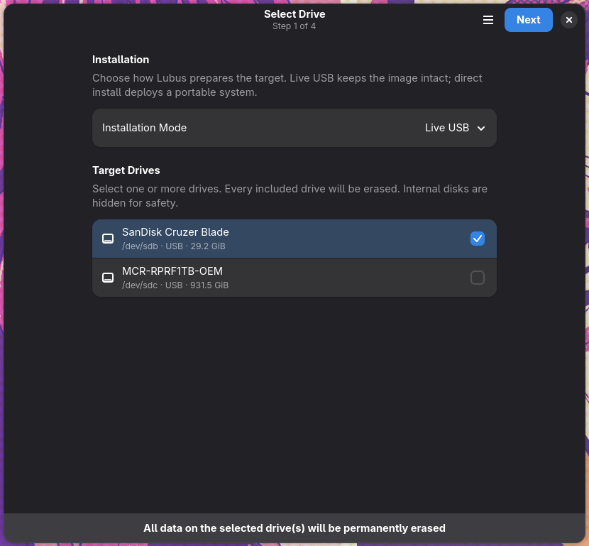
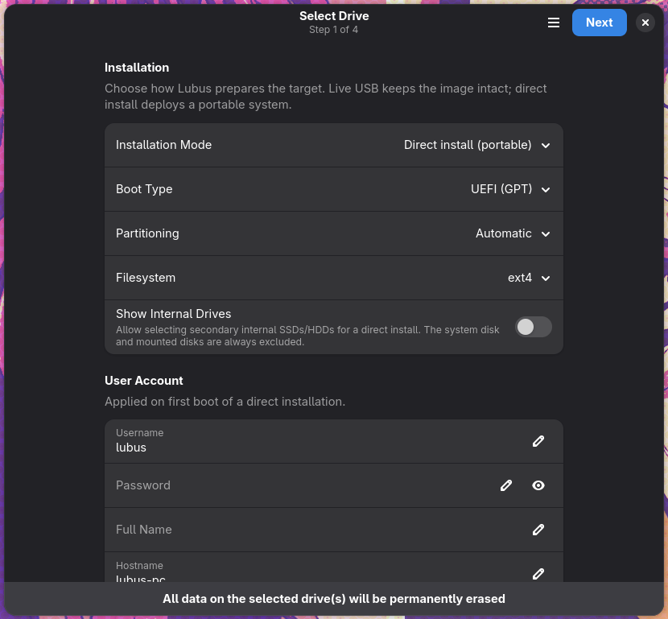
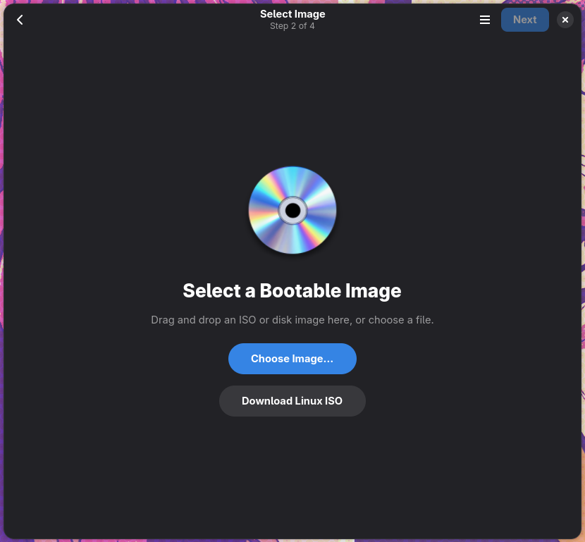
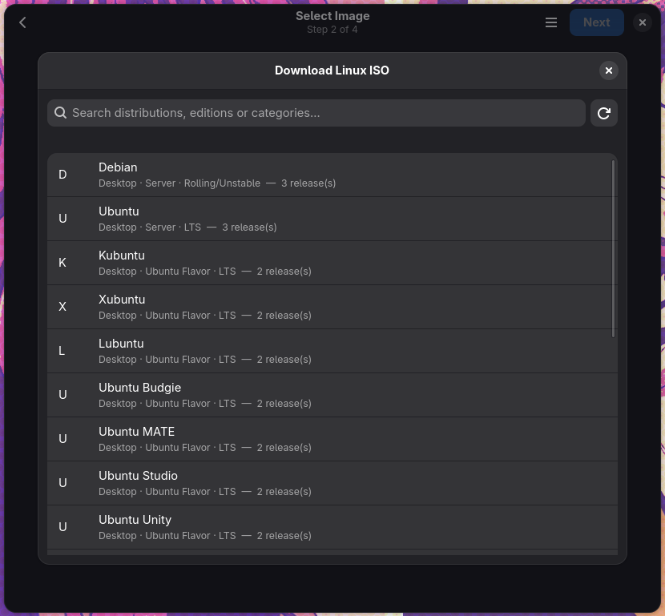
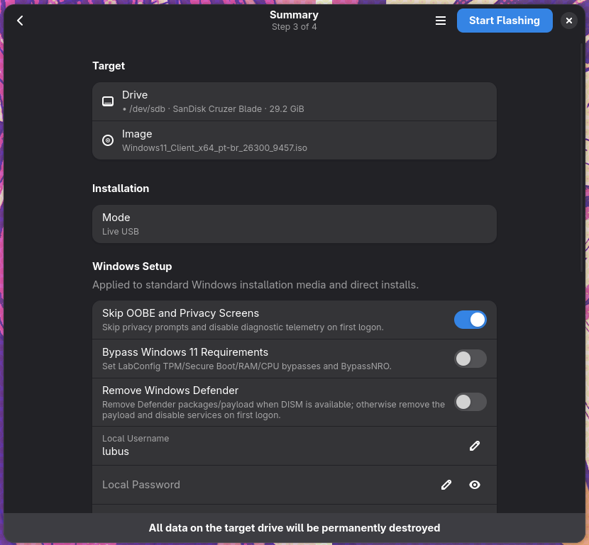
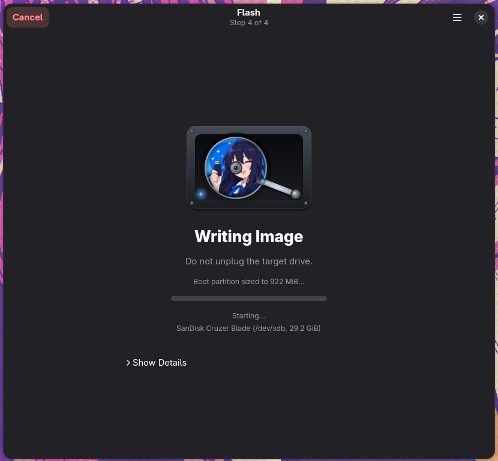

# Lubus

A modern, native Linux application for creating bootable USB drives and deploying portable operating systems. Lubus is built with **GTK4**, **Libadwaita**, and **Python** using GObject introspection.

[](LICENSE)
[](https://python.org)
[](https://gtk.org)
[](https://gnome.pages.gitlab.gnome.org/libadwaita/)

## Features

- **Native GNOME interface**: a clean libadwaita layout with grouped settings, accessible rows, dialogs, and responsive pages.
- **Drive detection**: lists removable USB drives and SD cards with model, device path, bus type, and capacity. Internal system and mounted drives are excluded by default.
- **Two-drive summary with multi-target selection**: the dashboard shows the first two drives; **More Drives…** opens a dialog with every detected drive and a **Select All** master control.
- **Image selection**: choose local ISO, IMG, DD, RAW, or BIN files, with automatic image-type detection.
- **Linux ISO downloader**: browse Debian, Ubuntu, Kubuntu, Xubuntu, Lubuntu, Ubuntu Budgie, Ubuntu MATE, Ubuntu Studio, and Ubuntu Unity editions, resolve mirrors automatically, and verify downloads with SHA-256.
- **Live USB mode**: write a bootable installer image directly to one or more drives.
- **Direct install / portable mode**: deploy a portable system with automatic or custom partitioning and unattended user provisioning.
- **Windows deployment options**: create Windows installer media, configure Windows To Go-style portable installs, skip OOBE screens, bypass Windows 11 requirements, and optionally remove Windows Defender.
- **Writing modes**: DD block copy or ISO file extraction, depending on the image.
- **Progress and results**: live speed, ETA, target information, result actions, and a technical log.
- **Safety checks**: destructive confirmation, system-disk filtering, drive identity verification, safe unmounting, and optional verification after writing.

## Screenshots

| Select Drive | Direct Install / Portable |
| --- | --- |
|  |  |

| Select Image | Download Linux ISO |
| --- | --- |
|  |  |

| Summary | Flashing |
| --- | --- |
|  |  |

## Architecture

```text
lubus/
├── __init__.py              # Package metadata
├── main.py                  # Application entry point
├── window.py                # Main window and wizard navigation
├── config.py                # User configuration
├── pages/                   # GTK4/Libadwaita pages
│   ├── base.py              # Shared page loader
│   ├── drive_page.py        # Step 1: installation mode and target drives
│   ├── drive_dialog.py      # All-drives dialog with Select All
│   ├── image_page.py        # Step 2: image selection and write options
│   ├── iso_download.py      # Linux ISO catalog and downloader UI
│   ├── summary_page.py      # Step 3: confirmation and Windows options
│   ├── flash_page.py        # Step 4: progress, result and logs
│   ├── disc.py              # Interactive disc artwork
│   └── hdd.py               # Animated HDD progress artwork
├── core/                    # Non-GTK application logic
│   ├── devices.py           # Drive enumeration and identity
│   ├── images.py            # Image analysis and detection
│   ├── partitions.py        # GPT/MBR partition layouts
│   ├── writer.py            # Live USB write operations
│   ├── direct_install.py    # Portable installation logic
│   ├── multi_flash.py       # Parallel progress aggregation
│   ├── provisioning.py      # Linux and Windows unattended setup
│   ├── windows_install.py   # Windows installer media
│   ├── windows_togo.py      # Portable Windows deployment
│   ├── windows_boot.py      # UEFI/BIOS boot files
│   ├── windows_debloat.py   # Optional Windows cleanup
│   ├── iso_catalog.py       # Distribution catalog and mirrors
│   ├── iso_downloader.py    # Segmented downloads and SHA-256 checks
│   ├── bcd.py               # Windows BCD handling
│   ├── verify.py            # Write verification
│   └── icon_utils.py        # Icon helpers
├── udisks/                  # UDisks2 D-Bus client
│   ├── __init__.py
│   └── client.py
└── utils/                   # Shared helpers
    ├── i18n.py
    ├── logging.py
    ├── resources.py
    └── threading.py
```

## Requirements

### Runtime

- Python 3.10 or newer
- PyGObject
- GTK 4.10 or newer
- Libadwaita 1.3 or newer
- UDisks2
- Polkit
- `dosfstools` for FAT32
- `ntfs-3g` for NTFS
- `exfatprogs` for exFAT
- `e2fsprogs` for ext4
- `btrfs-progs` for btrfs
- wimlib for Windows image handling
- GRUB tools for BIOS and UEFI boot files

### Build

- Meson 1.0 or newer
- Ninja
- `pkg-config`
- Gettext
- `desktop-file-validate`
- `appstream-util`
- GTK4, Libadwaita, GLib, and GObject development packages

## Installation

Download the artifact for your distribution from the [Releases](https://github.com/INIT-D43M0N/Lubus/releases) page.

### Fedora

```bash
sudo dnf install ./lubus-5.0.0-5.fc45.noarch.rpm
```

### SUSE Linux Enterprise / openSUSE

```bash
sudo zypper install ./lubus-5.0.0-5.fc45.noarch.rpm
```

### Ubuntu / Debian

```bash
sudo apt install ./lubus_5.0.0-1_all.deb
```

### From source

```bash
git clone https://github.com/INIT-D43M0N/Lubus.git
cd Lubus

meson setup builddir --prefix=/usr
meson compile -C builddir
sudo meson install -C builddir
```

## Usage

1. **Select Drive** — choose Live USB or Direct install, then select one or more target drives.
2. **Select Image** — choose a local image or download a Linux ISO.
3. **Review Summary** — confirm the image, targets, installation mode, and Windows options.
4. **Flash** — start the write and follow progress until completion.

When more than two drives are connected, use **More Drives…** to open the complete drive list and include several targets at once.

## Safety

- Internal system and mounted drives are excluded by default.
- A warning banner and confirmation dialog are shown before destructive writes.
- Drive serial numbers and WWNs are checked before writing to prevent a target swap.
- Privileged operations use UDisks2 and Polkit; Lubus does not run as root.
- Partitions are unmounted safely before and after operations.
- Optional verification is available for supported raw writes.

## Development

### Run tests

```bash
python3 -m pytest tests/
```

### Build with Meson

```bash
meson setup builddir
meson compile -C builddir
meson install -C builddir
```

### Code style

```bash
ruff check lubus/
ruff format lubus/
```

## Contributing

1. Fork the repository.
2. Create a feature branch.
3. Make your changes.
4. Run the tests and linters.
5. Open a pull request.

## License

GPL-3.0-or-later. See [LICENSE](LICENSE) for details.

## Acknowledgments

- [GTK](https://gtk.org/) and [Libadwaita](https://gnome.pages.gitlab.gnome.org/libadwaita/) for the native Linux interface.
- [UDisks2](https://www.freedesktop.org/wiki/Software/udisks/) for safe, Polkit-integrated disk operations.
- [wimlib](https://wimlib.net/) for Windows image handling.
- [GRUB](https://www.gnu.org/software/grub/) for bootloader support.
